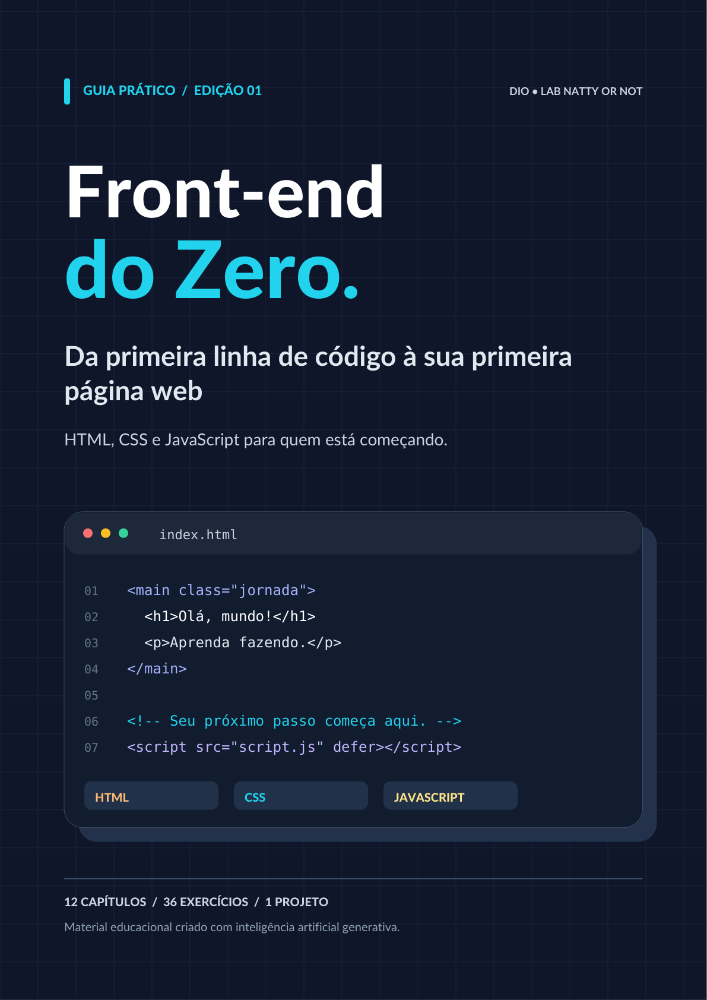
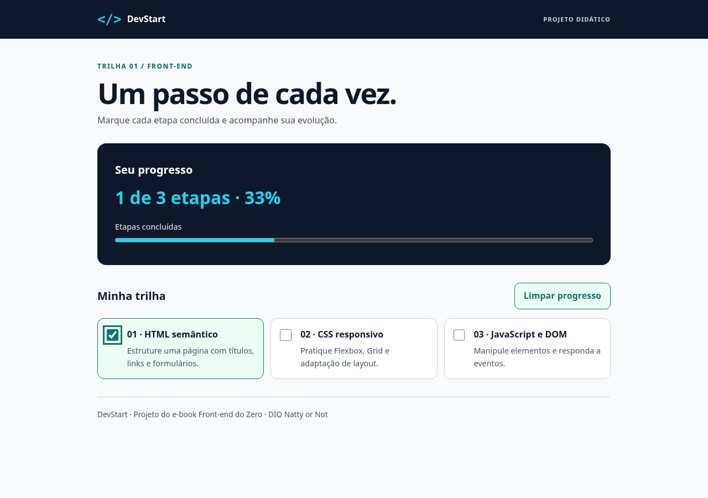
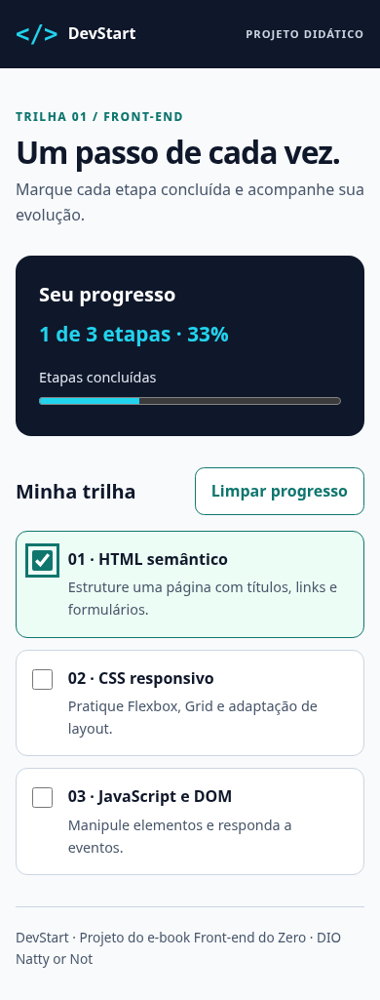

# Front-end do Zero 🚀

> Da primeira linha de código à sua primeira página web.

Projeto educacional desenvolvido para o desafio **Lab Natty or Not**, da Digital Innovation One (DIO), com auxílio de inteligência artificial generativa.

<p align="center">
  
</p>

## 📒 Descrição

**Front-end do Zero** é um e-book introdutório em português sobre desenvolvimento web. O material reúne 43 páginas, 12 capítulos, 36 atividades práticas com respostas comentadas e um projeto final chamado DevStart, que permite acompanhar o progresso de uma trilha de estudos.

A proposta é mostrar como uma IA generativa pode contribuir para a produção de um material educacional com organização editorial, identidade visual consistente e aplicações práticas, sem esconder sua origem.

## 🤖 Tecnologias Utilizadas

- **ChatGPT:** apoio na elaboração do conteúdo, exemplos de código, documentação e design editorial.
- **Python e ReportLab:** diagramação, capa vetorial, diagramas e geração do PDF.
- **HTML, CSS e JavaScript:** exemplos e implementação do DevStart.
- **Chromium e Playwright:** testes de interação e responsividade em ambiente controlado.
- **Git e GitHub:** ferramentas previstas para versionamento e publicação do projeto.

## 🧐 Processo de Criação

1. Definição do tema, público iniciante e objetivos de aprendizagem.
2. Planejamento dos capítulos e produção de explicações, exemplos e exercícios com auxílio de IA.
3. Criação de uma identidade visual em azul-marinho, ciano e verde-petróleo, com blocos de código e diagramas.
4. Implementação de exemplos práticos e do painel DevStart sem dependências externas.
5. Geração do PDF, inspeção visual das páginas e testes controlados do código.
6. Organização da documentação e dos arquivos para revisão e publicação no GitHub.

O [registro de prompts e decisões](prompts/prompts-utilizados.md) detalha o processo. A publicação deve ser precedida de revisão pessoal, execução local e adaptação da reflexão à experiência real.

## 🚀 Resultados

| Entrega | Acesso |
|---|---|
| E-book completo (43 páginas) | [Ler PDF](ebook/frontend-do-zero.pdf) |
| Capa | [Ver PNG](assets/capa.png) |
| Exemplos de HTML, CSS e JS | [Abrir pasta](exemplos/) |
| DevStart | [Código do projeto](projeto-final/) |
| Registro de testes | [Ver resultados e limitações](TESTES.md) |

### DevStart — minha trilha de estudos

O painel inclui checkboxes nativos, indicador de progresso, botão de reinicialização e armazenamento local. Seu layout adapta-se à largura da tela.



<details>
<summary>Visualizar versão mobile</summary>



</details>

### Como executar

Clone o repositório publicado ou extraia os arquivos. Na raiz do projeto, execute, se tiver Python 3 instalado:

```bash
python3 -m http.server 8000
```

No Windows, use `py -m http.server 8000`, se necessário. Depois, acesse `http://localhost:8000/projeto-final/` no navegador. Os exemplos podem ser abertos nos caminhos `/exemplos/html/`, `/exemplos/css/` e `/exemplos/javascript/`. Não há instalação de dependências para executar o front-end. Use Ctrl+C para encerrar o servidor.

### Conteúdo do e-book

Fundamentos da Web · HTML semântico · CSS · Flexbox e Grid · Mobile First · JavaScript e DOM · Git e GitHub · Projeto DevStart · Introdução a React e TypeScript · Glossário · Exercícios e respostas.

## 💭 Reflexão

A produção de um conteúdo com aparência profissional por meio de IA não elimina a necessidade de revisão técnica, testes e curadoria. A qualidade de um material educacional depende da clareza das explicações, da precisão dos exemplos e da utilidade das atividades. O objetivo deste projeto não é disfarçar o uso de IA, mas demonstrar seu potencial como ferramenta de aprendizagem e produção.

> Material educacional independente, elaborado com auxílio de IA generativa para o desafio da DIO. Não é um curso oficial da plataforma.

**#LabDIONattyOrNot**
